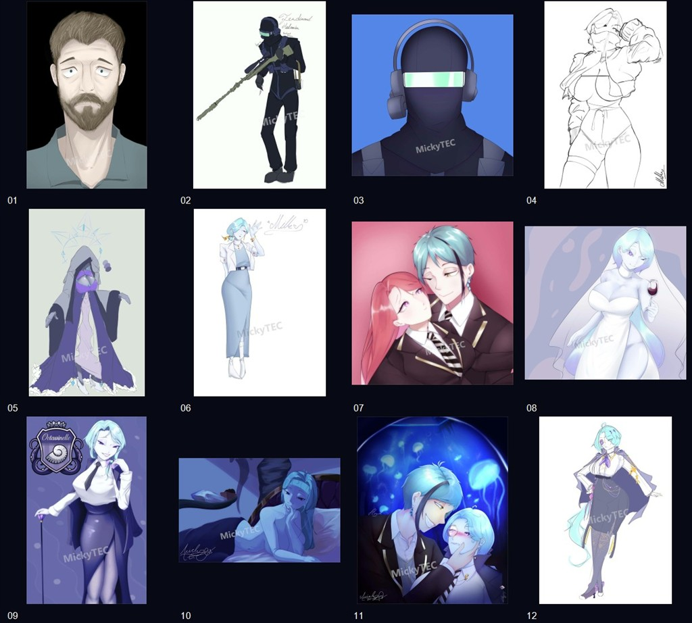

# MickyTEC Gallery — Portfolio

## ภาพรวมและวัตถุประสงค์

เว็บไซต์ Frontend สำหรับจัดแสดงผลงานจริงของศิลปิน **MickyTEC** และนำเสนอการพัฒนา Gallery ด้วย React และ TypeScript สำเนานี้แยกจากโปรเจกต์ต้นฉบับ ใช้เฉพาะภาพย่อที่ใส่ลายน้ำแล้ว และใช้ประวัติ Git ใหม่สำหรับ Private Repository เท่านั้น การเปิด Public หรือ Deploy ยังต้องรออนุมัติ

## บทบาทของผู้พัฒนา

งานที่นำเสนอคือการพัฒนาและปรับปรุง Frontend: จัดโครงสร้างข้อมูลและเชื่อมภาพจริงเข้ากับ Gallery, Filters และ Lightbox จัดวางแพ็กเกจ ปรับข้อความและเครดิต รักษาธีมและ Responsive Layout เดิม พร้อมตรวจ TypeScript, Tests และ Build ผู้พัฒนาเว็บไม่ได้อ้างว่าเป็นผู้วาดหรือเจ้าของสิทธิ์งานศิลป์

## เทคโนโลยีที่ใช้

เวอร์ชันจาก `package-lock.json`:

- React / React DOM 18.3.1
- TypeScript 5.9.3
- Vite 6.4.4 และ React plugin 4.7.0
- Tailwind CSS 3.4.19, PostCSS และ Autoprefixer
- Lucide React 0.475.0 สำหรับไอคอน
- Node.js สำหรับ Tests ด้วย React server rendering และ `node:assert`

## ฟีเจอร์ที่พัฒนาจริง

- Home: หัวข้อ `Micky TEC` / `Twisted wonderland` พร้อมข้อความสีรุ้งพาสเทล
- Featured Artworks เปิด Lightbox ของภาพที่เลือก
- Gallery ผลงานจริงครบ 12 ภาพ คงลำดับเดิม ใช้ชื่อแบบหมายเลขอ้างอิง
- Filters: ทั้งหมด, Full-Body, Half-Body และ Character Design ไม่มีหมวด Chibi
- เปิดภาพด้วย Click, Enter หรือ Space; ปิด Lightbox ด้วยปุ่ม พื้นหลัง หรือ Escape พร้อมจัดการโฟกัสและการเลื่อนหน้า
- UI แพ็กเกจ Bust Up **200 THB**, Half Body **400 THB**, Full Body **800 THB** พร้อมเลือกแพ็กเกจและคัดลอกข้อความ ไม่ส่งคำสั่งซื้อ
- About: เครดิต MickyTEC และรูปโปรไฟล์ย่อ ไม่แสดงชื่อส่วนตัว อายุ หรือบัญชี Social ส่วนตัว
- หน้าข้อมูลเครดิตและสิทธิ์การใช้ภาพแทนช่องทางติดต่อส่วนตัว
- ธีมสีหลัก 6 สี ไม่มีรหัส HEX หรือปุ่มคัดลอกสีใน UI
- เมนูจอเล็กและ Layout ตามขนาดหน้าจอ รักษาธีม Navy/Purple และ Animations เดิม

## โครงสร้างโปรเจกต์

```text
MickyTEC_Gallery_Portfolio/
  src/
    components/                 Home, Gallery, Lightbox, About และส่วนอื่น
    data/                       ข้อมูลผลงาน เครดิต และแพ็กเกจ
    types/                      ชนิดข้อมูล TypeScript
    App.tsx
    index.css
    main.tsx
  public/artworks/               ภาพย่อมีลายน้ำ 12 รูป, รูปโปรไฟล์ย่อ และ SVG ของ UI
  previews/artwork-samples.jpg   ภาพรวมตัวอย่างที่ผ่านการยืนยัน
  scripts/                      สคริปต์ทดสอบ
  tests/fixtures/               ขนาด Checksum และข้อมูลลายน้ำ
  README.md
  ARTWORK_CREDITS.md
  SOURCE_CODE_LICENSE.md
  PORTFOLIO_REVIEW.md            ผลตรวจจากโฟลเดอร์แยก
  package.json
  package-lock.json
  vite.config.ts
  tsconfig.json
  tailwind.config.js
  postcss.config.js
  index.html
  .gitignore
```

## วิธีติดตั้งและใช้งาน

รันจากโฟลเดอร์นี้โดยตรง โดยมี Node.js และ npm ติดตั้งไว้ เวอร์ชันที่ใช้ตรวจคือ Node.js 24.22.0 และ npm 11.19.1

```powershell
npm.cmd ci
npm.cmd run dev
```

Dev server ตั้งพอร์ต 3001 ให้ดู URL จริงจาก Terminal ไม่มี API Key หรือไฟล์ `.env` ที่ต้องตั้งค่า

ตรวจคุณภาพและเปิดผล Build ในเครื่อง:

```powershell
npm.cmd run typecheck
npm.cmd run build
npm.cmd test
npm.cmd run preview
```

Tests อ่านไฟล์ใน `dist/` จึงต้อง Build ก่อน หากตั้งตัวแปร `MICKYTEC_BUILD_DIR` ไว้ Tests จะอ่านผล Build จากตำแหน่งนั้นแทน `node_modules/` และ `dist/` สร้างในเครื่องและถูกละเว้นโดย `.gitignore` ไม่ใช่ไฟล์สำหรับนำขึ้น Repository

## เครดิตศิลปินและสิทธิ์การใช้ภาพ

เครดิตงานศิลป์: **MickyTEC** ใช้ภาพจริงครบ 12 รูปและรูปโปรไฟล์ย่อ ไม่มีภาพ AI มาทดแทน ไม่มีภาพต้นฉบับหรือ Git History เดิมอยู่ในสำเนานี้

ผลงานมีด้านยาวไม่เกิน 1,024 พิกเซล ลายน้ำ MickyTEC ความทึบประมาณ 25% อยู่ด้านในตามองค์ประกอบ ตำแหน่งและความทึบได้รับการยืนยันแล้ว รูปโปรไฟล์มีขนาด 384 × 351 พิกเซล ภาพรวมตัวอย่างมีขนาด 1,024 × 922 พิกเซล ไม่คัดลอก EXIF/XMP/IPTC/GPS จากต้นฉบับ



**สิทธิ์ Source Code และ Artwork แยกจากกัน**:

- Source Code: ยังไม่ได้เลือกใบอนุญาต Open Source การเตรียม Portfolio นี้ไม่ให้สิทธิ์ใช้งานต่อโดยอัตโนมัติ ดู [SOURCE_CODE_LICENSE.md](SOURCE_CODE_LICENSE.md)
- Artwork: ไม่ให้สิทธิ์ใช้ซ้ำ ดัดแปลง แจกจ่าย จำหน่าย หรือถอดลายน้ำโดยอัตโนมัติ รวมทั้งรูปโปรไฟล์และภาพตัวอย่างใน README ดู [ARTWORK_CREDITS.md](ARTWORK_CREDITS.md)
- ก่อนเปิด Public ต้องอนุมัติการเผยแพร่สำเนาและยืนยันขอบเขตสิทธิ์ของภาพ/ตัวละครที่เกี่ยวข้อง การอนุมัติลายน้ำไม่ถือเป็นการอนุมัติเผยแพร่

## ข้อจำกัดของระบบ

- เป็น Frontend Showcase ไม่มี Backend, ฐานข้อมูล, ระบบชำระเงิน หรือระบบรับคำสั่งซื้อจริง
- แบบฟอร์มใช้ state ในเบราว์เซอร์และคัดลอกข้อความ ไม่ส่งข้อมูลอัตโนมัติ
- สลับหน้าด้วย React state ไม่ใช้ URL Router; Refresh จะกลับ Home
- ไม่แสดงเงื่อนไข Commission ที่ยังไม่ได้ยืนยัน
- ชื่อผลงานใช้หมายเลขและหมวดเป็นการจัดกลุ่มเพื่อแสดงผล ไม่ใช่ชื่อ/หมวดทางการที่ศิลปินยืนยัน
- โหลดฟอนต์จาก Google Fonts จึงมีการเชื่อมต่อภายนอกเมื่อเปิดเว็บ หากโหลดไม่ได้จะใช้ฟอนต์สำรอง
- Tests ใช้ React server rendering และ state/DOM จำลอง ไม่ทดแทน E2E หรือการตรวจ Responsive ในเบราว์เซอร์จริง
- ลายน้ำและภาพย่อไม่รับประกันการป้องกันการคัดลอก
- ยังไม่ได้ตั้งค่าโฮสต์หรือ GitHub Pages ในรอบนี้

ดูผลตรวจและรายการที่ต้องอนุมัติก่อนเผยแพร่ที่ [PORTFOLIO_REVIEW.md](PORTFOLIO_REVIEW.md)
